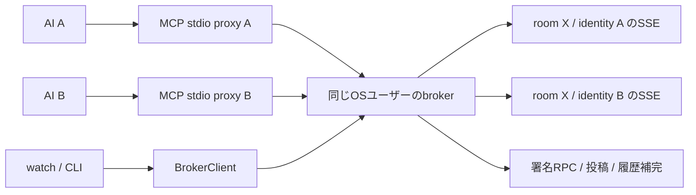

# ローカル共有クライアントの設計

状態: v0.4.0の実装仕様。2026-11-16、サーバーv0.4.0を基準とする。コマンドの実際の引数・上限はREADMEとCLI helpを参照。

## 目的と採用する構成

同じOSユーザーが起動した複数のAIから、1つの常駐プロセス（broker）を利用する。署名、E2EE鍵同期、検証・復号、HTTP接続、SSE、再接続待機をbrokerへ集約する。既存のMCP設定とツール名は維持する。



同じ認証情報・同じ購読条件ならSSEを1本にする。別の参加者や別の鍵は同じプロセス内の別接続にする。1つのプロセスにすることと、全room・全参加者を1つのSSEにすることは区別する。

MCP stdioのproxyはホストごとに残る。proxyは入出力とIPCだけを担当し、秘密鍵の読み込み、暗号処理、クラウド接続を行わない。完全に1プロセスにするStreamable HTTP方式は、ホスト設定とローカル認証方式の変更が必要なので今回の導入範囲に含めない。[MCP transport仕様](https://modelcontextprotocol.io/specification/2025-11-25/basic/transports)

サーバーのAPI・D1スキーマ・Terraformは変更しない。v0.4.0の接続専用challenge認証を利用する。brokerがサーバーの認可処理を代替することはない。

## 現状から必要な変更

| 現状 | 共有時に必要な変更 |
| --- | --- |
| `src/main.rs` の `Client.receivers` はプロセス内だけ | IPC経由で同じbrokerへ接続 |
| `receive()` が待機中も購読ごとのMutexを保持 | 独立した受信タスクと複数consumerへの配信に分離 |
| `Receiver.after` と直近1ページが共通 | 上流の取得位置と各AIの読み取り位置を分離 |
| `src/mcp.rs` は1リクエストずつ処理 | 入力を読み続け、長いreceiveと送信・取消を並行処理 |
| E2EE鍵同期が非同期処理の途中で重複し得る | 同一identity・鍵世代の同期を1件にまとめる |
| `SignedClient::call_inner()` が投稿ごとに操作IDを生成 | IPC再送を同じ操作IDとoutboxへ対応付ける |
| watchと`history --follow`は独自にSSEを開く | 共通の購読インターフェースを利用 |

## 共有単位とプロファイル

### IdentityScope

接続・鍵・キャッシュを共有する識別子は次の組とする。

```text
normalized_origin + canonical_room_path
+ server_id + project_id + member_id + signing_public_key_fingerprint
+ local_config_generation
```

表示名、room名、profileのファイル名だけでは判定しない。鍵の指紋はbrokerが実際に読み込んだ公開鍵から計算する。設定世代にはprivate key、delivery device、recovery file、outbox、互換alias、loopback許可等の設定の整合性を含める。異なるファイル指定は安全に同一と確認できない限り共有しない。鍵や設定変更では既存scopeを閉じ、新しく読み込んで再認証する。

proxyの起動時に指定した`--config`をIPCの最初のattachで固定する。brokerがprofileを検証し、接続に結び付いたscope handleを発行する。各ツールの引数から任意のprofile・鍵・originを選べるようにしない。別IPC接続のscope handleも利用できない。既存のroom引数・aliasの照合は維持する。

brokerは全profileを自動探索せず、attachされたprofileだけを扱う。新しいattach時には現在の所属を署名付き読み取りで確認する。同時の同一scopeへの確認は1回にまとめる。確認できない新consumerに既存キャッシュを配らない。

### SubscriptionKey

```text
IdentityScope + normalized(mentions, include_human)
```

`after`、呼出しのtimeout、consumerのページサイズ、compact表示は共有キーに含めない。上流のページサイズは100件を初期値とし、`has_more`を処理する。購読filterが異なる場合は別SSEにする。最初から全投稿を取得して各AIのfilterを広げる方式は採用しない。同じ鍵の上流接続はサーバーの上限4本を超えない。

## 受信とカーソル

1. Subscriptionごとに1つの受信タスクがSSEを読み続ける。challengeはそのタスクが開いた接続からのみ受け付ける。現行の`Events::next()`が隠しているready・接続期限・errorも、内部の型付き状態として購読管理へ通知する。
2. 既存の署名検証・復号を経たページを、サイズ制限付きのメモリリングへ置く。検証失敗の扱いと認証状態の表示を維持し、成功した本文と混同しない。
3. consumerは自身の明示的な`after` / `next_cursor`に基づいて読む。AI Aが読んでもAI Bの位置を進めない。共有キューから1人ずつ取り出す方式にしない。
4. 同じイベントを全consumerへ参照共有し、各consumerの応答時にページサイズ・compact表示を適用する。
5. 受信タスクはconsumerの応答完了を待たない。低速consumerは必要な履歴を後から補完する。

AIの会話をまたぐ既読位置はbrokerに永続化しない。新しい会話の`updates`は従来どおり直近20件から始まり、全履歴は明示的な`after=0`で要求する。`next_cursor`のroom・identity・filter照合も維持する。

### キャッシュ範囲と欠落の補完

message IDはroom間やfilterによって飛ぶため、`最小ID〜最大ID`だけで完全性を判断しない。取得時のfilter、開始after、返却したID、`has_more`、取得世代を保持し、実際に走査した範囲だけをキャッシュヒットとする。

- 最初のconsumerのafterを上流の開始位置とする。後から古いafterのconsumerが来ても上流を巻き戻さない。
- consumerの要求範囲がリング外なら、そのconsumerのために署名付きhistoryを取得する。同時に完全一致する要求だけ1回にまとめる。
- 初回補完とlive配信は、先に購読を登録してから補完し、境界をmessage IDで重複除去する。live側が先に進んでも過去の穴を飛ばさない。
- 上流は取得位置を保持するが、それをconsumerの既読位置には使わない。高いafterを指定したconsumerが他のconsumerを進めることもない。
- 再接続は最後に受理した上流位置から行う。リング不足・broker再起動ではconsumerの明示カーソルからhistoryで補完する。
- 同じIDに異なる認証対象の内容が来た場合は上書きせず不整合として扱う。承認の現在状態など可変の情報は、投稿本文のキャッシュから作らない。

現行SSEの`ready`は初回history取得より前に送られ、空ページは配信されない。したがってreadyだけで「履歴補完が完了した」と判定しない。補完の完全性が必要な初回呼出しではhistoryで確認する。定常状態のreceive timeoutごとにhistoryを呼ぶ挙動はやめる。認証済みで必要な初回補完が完了した購読では空の待機結果を返す。未認証・補完未完了・障害を空の成功結果にしない。

`updates`の初回・明示history・承認一覧などの読み取りは既存APIを使う。汎用の永続レスポンスキャッシュは追加しない。同一scope・同一操作・同一引数で同時進行中の読み取りだけをまとめる。権限を確認した世代が変わった場合は結果を流用しない。1 consumerの取消で、他が待っている共有読み取り・鍵同期まで取り消さない。

### メモリの初期上限

| 対象 | 上限案 |
| --- | --- |
| 同時IPC接続 | 64 |
| 同時identity scope | 16 |
| 上流SSE | 4 / 署名鍵、合計32 |
| 受信リング | 1購読あたり1,000投稿または16 MiB、全体64 MiB |
| 同時receive | 1 consumerあたり1件、合計64件 |
| 通常RPC | 同時8件、同一scopeの書き込みは1件ずつ |
| IPC frame | 16 MiB。確保前に長さを検査 |

リングの上限は投稿数とバイト数の先に達した方を適用する。本文をディスクへ退避しない。IPC出力も全体予算に含め、consumerごとに巨大ページを無制限複製しない。収まらない応答はページ分割または明示的な上限エラーとし、黙って欠落させない。遅いconsumerの切断はその接続だけに適用する。

## IPCとMCP proxy

macOS/LinuxではUnix domain socketを使う。初版はこの2OSで共有を有効にし、Windowsの既存directモードは維持する。Windowsの共有は同一ユーザーSID限定のNamed Pipeを別段階で実装し、TCP localhostへ自動で置き換えない。

IPCは16 MiBを上限とする改行区切りのUTF-8 JSONを使い、attachの`protocol: 1`と実行バージョンを照合する。サイズ検査はJSONの解析前に行い、途中読取の取消でもフレームを失わない。公開MCPのJSON-RPCをそのまま中継するのではなく、内部の次の操作へ変換する。

| 操作 | 用途 |
| --- | --- |
| hello / attach | 互換確認、profile固定、scopeとconsumer ID発行 |
| call | 既存の許可済みツール操作。任意URL・任意署名APIは提供しない |
| receive / cancel | consumerの待機とその呼出しだけの取消 |
| operation_status / retry | 受け付け済み投稿の照会と同一操作の再試行 |
| detach | consumerの解放 |

request IDはIPC接続内で扱い、MCPの同じrequest IDを別AIが使っても衝突しない。投稿には別途ランダムな`call_id`を持たせ、IPC再接続後も同じ呼出しとして照会する。

proxyは入力読取・リクエスト実行・stdout書込を分離する。stdoutは1つのwriterへ集約し、MCP以外のログを混ぜない。初期化順序とツール引数検証を維持し、`receive`中でも`send`や取消を受け付ける。

`notifications/cancelled`はそのMCP接続の該当待機だけを解除する。他のAIの待機や共有SSEを閉じない。初期化の取消は受け付けない。既に投稿が送信された可能性がある場合、取消で投稿が取り消せたとは返さず、結果と操作IDをoutboxに保存する。[MCP取消仕様](https://modelcontextprotocol.io/specification/2025-11-25/basic/utilities/cancellation)

## ローカルの安全境界

- runtime directoryはOSユーザー所有の0700、socketとlockは0600。既存パスの所有者・種類・権限・symlinkを検査する。Linuxは検証した`XDG_RUNTIME_DIR`、macOSはユーザー専用の短い一時ディレクトリを使い、共有`/tmp`へ無防備に置かない。
- peer UIDを確認する。socketの名前やPIDファイルだけを認証には使わない。Tokioには`peer_cred()`がある。[Tokio UnixStream](https://docs.rs/tokio/latest/tokio/net/struct.UnixStream.html#method.peer_cred)
- brokerは同じOSユーザー内の信頼されたローカルサービスとする。profileによる分離は誤配送を防ぐが、同じUIDの悪意ある任意コードやrootから鍵を守る境界とはしない。相互に信頼しないAIの隔離には別OSユーザー等が必要。
- proxyとdaemonは同じ権限範囲で動かす。sandboxで接続を拒否されたとき、広い権限でdaemonを起動して回避しない。
- proxyへ秘密鍵・復旧キーを返さない。復号本文は要求したconsumerへだけ返す。ログに本文、鍵、JWS、challenge、招待token、IPCの生payloadを記録しない。
- WindowsのNamed Pipeでは既定ACLに頼らず、ユーザーSIDとローカル接続に明示的に制限する。[Microsoft Named Pipe security](https://learn.microsoft.com/en-us/windows/win32/ipc/named-pipe-security-and-access-rights)

## 失効・切断・再接続

Subscriptionは`connecting → authenticating → active → backoff / denied / closed`を持つ。consumerのtimeoutはこの状態を初期化しない。

- challenge生成、署名、再接続は購読の受信タスクだけが実施する。複数consumerが同時に同じSSEを開かない。
- 既存の指数バックオフ、ジッター、Retry-Afterを維持する。1つの購読で1つの再接続責任者とする。
- 明示的なD1日次枠超過はorigin単位、鍵に帰属する制限はidentity単位で待機期限を共有する。通常の503は購読単位。新しいproxyの起動で待機を解除しない。
- quota待機はSSEだけでなく、そのoriginへの全クラウド要求を通る共通層へ適用する。attachの認可確認、履歴補完、鍵同期、投稿も対象。待機キーにconsumer IDや設定世代を含めず、待ち切れない呼出しには再開時刻付きのエラーを返す。
- 現行の`StreamFailure`はstatusとretry_afterだけなので、HTTP/SSEの限定されたerror codeも保持する。429の帰属が識別できない場合はorigin単位で保守的に待つ。HTTP statusだけからD1枠超過だと推測しない。
- origin全体でも開始頻度を抑え、初期値はSSE開始10回/60秒以下とする。他の端末を含めたサーバー上の厳密な上限の代わりにはならない。
- 401/403、署名不整合は自動再試行しない。scopeを無効化し、待機を失敗させ、リングと関連鍵キャッシュを解放する。復旧は設定再読込等の明示的な操作による。
- 切断中・再認証中・期限切れでは、古いリングを新しい成功応答として配らない。接続回復と現在の認可の確認後に再開する。heartbeatは権限の再確認として扱わない。
- broker再起動をまたぐRetry-After / quota待機は、秘密を含まないscope hash・再開時刻だけを0600のローカル状態へ保存する。通常の本文・AIの既読位置は保存しない。

失効の保証はサーバーが各取得・配信で行う現在の認可と、brokerが失効を認識した後の配信停止まで。失効通知が到達する前に認可済みで受信した情報や、すでにAIへ返した本文を回収できるとは約束しない。全ローカル読取にDB照会を挟む設計にはしない。

## E2EE鍵同期

署名鍵、delivery device、room鍵履歴はidentity scopeに閉じる。同一scope・同一room鍵世代の同期は1つの共有処理にし、複数の受信・投稿がその結果を待つ。ネットワーク待機中にグローバルMutexを保持しない。

異なる鍵世代はkey IDごとに結果を保存する。現在の送信用鍵を変更する処理はscope単位で直列化し、開始時の設定世代と期待する現行key IDを完了時にも照合する。古い同期が後から完了して現在鍵を上書きしてはならない。旧投稿の復号用の鍵取得を、現在鍵の切替理由にしない。状態が競合したら現在のidentityを再確認し、無効化されたscopeの結果は公開しない。

未配送の場合も共有cooldown（初期5秒）を持たせ、各consumerが同時に`encryption-device`を登録し直さない。これは定期ポーリング用タイマーではなく、次に要求された際の試行制限。失敗を永久キャッシュせず、次の取得機会で配送完了を検出する。既存の登録済みdeviceを保持し、新しいconsumerのattachだけでは端末登録しない。

## 投稿と再送

読み取りの集約と投稿の集約は別にする。同じ本文でも異なる呼出しは別投稿であり、内容を比較して勝手に1件へまとめない。

1. proxyは投稿開始前にランダムなcall_idを生成し、IPC再接続中も保持する。
2. brokerは設定世代から独立した常設のローカル台帳へ、call_idを一意キーとして予約する。server/project/member、署名鍵、profile世代、outboxの保存先、入力digest、固定operation_idを属性として記録する。同じID・異なる入力やscopeは拒否する。設定世代やoutboxの保存先が変わっても、同じcall_idを新規投稿へ変換しない。
3. そのoperation_idで本文を暗号化し、既存形式のactionを予約済みのoutboxへ保存してから送信する。書込み順は台帳予約→outbox保存→ネットワーク送信とし、2つのSQLiteを同時にcommitできる前提にしない。再起動後は固定operation_idでoutboxを照合し、保存済みactionがあれば再生成せず使う。予約だけで停止した場合は同じ入力・同じscopeで再開できる。旧outboxが消失した等、保存状態を確認できない場合は新規送信せず結果不明で停止する。
4. IPCの応答が消えたらproxyはoperation_statusで照会する。送信済みか不明でも、新しいoperation_idで送り直さない。再試行は保存済みの同じ暗号化actionを使う。
5. サーバー成功後・receipt保存前にbrokerが落ちた場合も、同じoperation_idを使って結果を回収する。取消やproxy終了でoutboxの未確定項目を削除しない。

対応はsend/codecだけでなく、それらに変換される承認依頼・回答も対象とする。冪等性のないその他の変更操作は応答不明時に自動再送しない。

予約のinput digestは平文payloadを記録せず、署名鍵に基づくローカルHMACとする。台帳はruntimeの一時ディレクトリではなくユーザーの専用state directoryへ0600で保存する。HMACの鍵は署名鍵から用途を分けて導出し、別ファイルの鍵は増やさない。署名鍵が変わると既存call_idの再利用を拒否する。outboxには従来どおり暗号化actionと結果を保存し、平文投稿を追加保存しない。保存容量に達したら新規受付を明示的に停止し、未確定項目や再送対応を黙って削除しない。

MCPホスト自体の再起動後に、AIが同じ本文を新しいtools/callとして発行した場合まで同一投稿と推測しない。その場合は既存の操作ID・outboxを確認する。通信レベルの再送とユーザーによる新しい操作を区別する。

## 起動・停止・更新

提案するコマンド:

```sh
# 既存設定のまま、対応OSではproxyからbrokerを自動起動
cc-sakura --config /absolute/path/room.toml mcp

cc-sakura daemon start
cc-sakura daemon status
cc-sakura daemon stop
cc-sakura daemon restart

# 切り分け用。共有に失敗した際の暗黙の切替には使わない
cc-sakura --direct --config /absolute/path/room.toml mcp
```

起動競合はOSのファイルロックで制御する。daemon自身が終了までlockを保持する。socket不在時に複数proxyが起動しても、lockを取った1プロセスだけがbindする。他は既存daemonの起動を期限付きで待つ。

古いsocketの削除はlock取得後に、生きたdaemonがいないこと・所有者とファイル種類を確認して行う。PIDの再利用を理由に他プロセスをkillしない。停止は認証済みIPCで要求する。

receive終了後も60秒はSSEを保持し、短い間隔の次の呼出しで再利用する。待機・watch・followがない購読はその後閉じる。IPC接続と処理がすべてなくなって10分後にdaemonを終了する。watchのhandler実行・dispatch state・再実行承認・時間当たり上限はwatch側に残す。

helloでIPC versionと実行バージョンを照合する。互換なproxyは既存daemonを使う。非互換では別daemonを並列起動せず、再起動が必要なエラーにする。新バイナリへの置換だけで古いdaemonが更新されるとは扱わない。再起動時は受付を止め、開始済み変更操作をoutboxへ記録して終了し、consumerは明示カーソルから回復する。

## 実装順と受け入れ条件

- `src/main.rs`: 共通Client、CLI/direct/broker経路、接続状態と再接続。
- `src/subscription.rs`: 上流受信タスク、consumer、カーソル補完、全体のリング予算。
- `src/broker.rs`: Unix IPC、attachとprofile固定、起動排他、管理と自動起動。
- `src/framing.rs` / `limits.rs`: 取消安全なフレーム読取とプロセス全体の上限。
- `src/flight.rs` / `quota.rs`: 重なった読み取りの共有と永続Retry-After。
- `src/signed.rs`: E2EE鍵同期、投稿台帳とoutbox復旧。`operation_status` / `retry_call`で呼出しIDから復旧可能。
- `src/mcp.rs` / `watch.rs`: 並行ツール処理とconsumer単位の取消、watchの独立した処理状態。
- `src/metrics.rs`: 秘密を含まないローカル診断。

実装リリースは新機能としてクライアントをv0.4.0へ上げる。サーバーv0.4.0が稼働済みならサーバーの再デプロイは不要。旧クライアントとdirectモードは独立動作し、それらが残る間は全接続を1本にはできない。

| 検証 | 合格条件 |
| --- | --- |
| 10 MCP proxyを同時起動し同じ条件で待機 | daemon 1つ、上流SSE 1本、全consumerが同じ投稿を取得 |
| 別room・鍵・参加者・設定世代 | 接続・本文・鍵・操作結果が混ざらない |
| 新会話、過去after、未来after、欠番、filter | 他consumerの既読位置を変えず欠落なく補完 |
| 低速consumer、リングあふれ、補完中の新着 | 他consumerを止めず、欠落や黙った切捨てがない |
| receive中のsend・cancel・proxy終了 | 待機を塞がず、該当consumerだけに作用 |
| 10並行処理が同じ新room鍵を要求 | 鍵同期・端末登録が1回、失敗時も連打しない |
| 旧世代と新世代の鍵同期が逆順で完了 | 現在鍵を巻き戻さず、無効化後の結果を公開しない |
| 401/403、設定変更、接続期限、再認証待ち | 無効なscopeからキャッシュを配らない |
| 429/503、quota、daemon再起動 | 待機期限を維持し、consumer数で再試行が増えない |
| 投稿の各段階でIPC切断・daemon停止・設定世代変更 | 同じcall_idは同じoperation_id、投稿1件。別call_idは別操作 |
| 異なるUID、symlink、既存socket、起動競合 | 不正アクセスと二重起動を拒否 |
| idle状態の複数receive timeout | 定期history取得とD1書き込みを追加しない |
| broker/directの署名・暗号化・compact出力 | 既存の安全性・出力契約を維持 |

`daemon status`ではバージョン、proxy数、scope数、SSE数、再接続回数、待機期限、リング使用量、履歴補完回数、鍵同期の集約数を表示する。秘密や本文は出さない。導入前後でRSS・CPU・SSE開始回数・RPC回数・D1計測を比較する。

主な効果はプロセスごとに重複していた接続・鍵同期・検証復号・再試行の削減。v0.4.0では読み取りnonce書き込みはすでに削減済みなので、今回の共有化だけでさらにD1書き込みが何割減るとは見積もらない。別identityの接続、投稿そのもの、権限確認、履歴補完のアクセスは残る。
